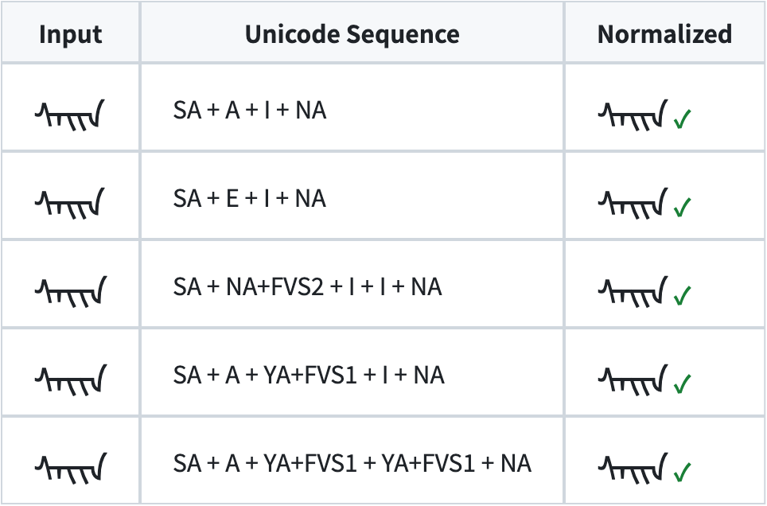

# mongol-norm

[](https://crates.io/crates/mongol-norm)
[](https://docs.rs/mongol-norm)
[](https://pypi.org/project/mongol-norm/)
[](https://github.com/Satsrag/mongol-norm/actions/workflows/test.yml)

[English](#english) | [中文](#中文)

---

<a id="english"></a>
## English

**mongol-norm** is a Traditional Mongolian (Hudum) same-shape comparison and normalization tool.
It is implemented according to the Mongolian shaping rules of UTN #57 (GB/T 25914—2023). It
converts Mongolian text that has the same written form but different Unicode encodings into a
unified encoding, making search, deduplication, and corpus processing easier. Rust crate with
zero dependencies, plus a Python package and a CLI.

### Input requirements

This library is intended for Mongolian text under the UTN #57 (GB/T 25914—2023) rules. Text that
uses other standards or encodings — for example Delehi, Oyun, and Menk related to
GB/T 25914—2010, as well as Menk old shape codes, ZCode, Zvvnmod, and the like — must first be
converted to UTN #57 (GB/T 25914—2023) before this library can be used. For encoding conversion,
you may consider [`mongol-convert`](https://github.com/Satsrag/mongol-convert); that library is
also currently in Beta, so use it with care and verify the conversion results.

### An example

Under the UTN #57 v4 shaping model, the following spellings have the same written form, but
their Unicode encodings differ, so a direct string comparison treats them as different text.
mongol-norm recognizes them as having the same abstract shape and produces the same normalized
result.



### Web playground

**[Try it online →](https://www.satsrag.dev/norm/)** — enter Mongolian text to see `shape`,
`norm`, Unicode code points, and vertical previews. Everything runs in your browser.

The [web playground](https://github.com/Satsrag/mongol-norm/blob/main/web/README.md) runs the Rust engine and renders input and
normalized text with the bundled `hudum.otf`. From this repository, run
`npm --prefix web run dev`, then open <http://127.0.0.1:4173> (see the web README for build prerequisites).

### Install

**Rust** (MSRV 1.82, zero dependencies, also builds for `wasm32-unknown-unknown`):

```bash
cargo add mongol-norm
```

or in `Cargo.toml`:

```toml
[dependencies]
mongol-norm = "0.4.2"
```

**Python** (CPython ≥ 3.9, no runtime dependencies, no Rust toolchain needed):

```bash
pip install mongol-norm
```

Prebuilt wheels cover Linux x86_64 / aarch64 (glibc and musl), macOS x86_64 / Apple silicon and
Windows x64. On other platforms pip builds from the source distribution, which needs Rust ≥ 1.83.

**Command line** — either of these puts `mongol-norm` on `PATH`:

```bash
cargo install mongol-norm
pip install mongol-norm
```

### Usage

`shape` returns the canonical written-unit sequence under mongol-norm's abstract shaping model
(UTN #57 v4 plus `mongfontbuilder`-derived data and rules). `same_shape` reports whether two
encodings produce the same written-unit sequence under that model — not whether they render
identically in every font. `normalize` maps a single word to one canonical Unicode string per
shape; `normalize_text` does the same for free-form text, normalizing Mongolian words and
leaving everything else unchanged.

> [!WARNING]
> **Beta.** `normalize` output is a unified encoding by **glyph shape**, **not standard spelling**,
> and may change in a later release. Keep the original text; when storing normalized keys, also
> record `canonical_version()` and rebuild after a version change.

### Rust

```rust
use mongol_norm::{Error, Locale, Shaper};

fn main() -> Result<(), Error> {
    let shaper = Shaper::new(Locale::Mng);

    shaper.shape_str("ᠰᠠᠢᠨ")?;     // U+1830 (SA) U+1820 (A) U+1822 (I) U+1828 (NA) → "S+A+I+I+A"
    shaper.shape_str("ᠰᠡᠢᠨ")?;     // U+1830 (SA) U+1821 (E) U+1822 (I) U+1828 (NA) → "S+A+I+I+A"
    shaper.shape_str("ᠰᠨ᠌ᠢᠢᠨ")?;   // U+1830 (SA) U+1828 (NA) U+180C (FVS2) U+1822 (I) U+1822 (I) U+1828 (NA) → "S+A+I+I+A"
    shaper.shape_str("ᠰᠠᠶ᠋ᠢᠨ")?;   // U+1830 (SA) U+1820 (A) U+1836 (YA) U+180B (FVS1) U+1822 (I) U+1828 (NA) → "S+A+I+I+A"
    shaper.shape_str("ᠰᠠᠶ᠋ᠶ᠋ᠨ")?; // U+1830 (SA) U+1820 (A) U+1836 (YA) U+180B (FVS1) U+1836 (YA) U+180B (FVS1) U+1828 (NA) → "S+A+I+I+A"
    shaper.same_shape("ᠰᠠᠢᠨ", "ᠰᠡᠢᠨ")?;            // → true
    shaper.normalize("ᠰᠡᠢᠨ")?;                     // → "ᠰᠠᠢ᠍ᠢ᠍ᠠ᠌"
    shaper.normalize_text("Hello ᠰᠡᠢᠨ world")?;     // → "Hello ᠰᠠᠢ᠍ᠢ᠍ᠠ᠌ world"
    Ok(())
}
```

Full API on [docs.rs](https://docs.rs/mongol-norm).

**Font backend** (`features = ["font"]`, Rust 1.85): the same `shape`, but computed by
[harfrust](https://github.com/harfbuzz/harfrust) (the Rust port of HarfBuzz) running the
Hudum font mongfontbuilder composes, bundled without its outlines (30 KB), instead of the
ported rules — what the reference font draws:

```rust
# #[cfg(feature = "font")] {
use mongol_norm::FontShaper;

let font = FontShaper::new();
assert_eq!(font.shape_str("ᠰᠠᠢᠨ")?, "S+A+I+I+A");
# }
# Ok::<(), mongol_norm::Error>(())
```

The default build stays dependency-free; `normalize` always uses the rule engine.

### Python

```python
from mongol_norm import MongolianShaper

shaper = MongolianShaper(locale="MNG")

shaper.shape("ᠰᠠᠢᠨ")          # U+1830 (SA) U+1820 (A) U+1822 (I) U+1828 (NA) → ['S', 'A', 'I', 'I', 'A']
shaper.shape("ᠰᠡᠢᠨ")          # U+1830 (SA) U+1821 (E) U+1822 (I) U+1828 (NA) → ['S', 'A', 'I', 'I', 'A']
shaper.shape("ᠰᠨ᠌ᠢᠢᠨ")        # U+1830 (SA) U+1828 (NA) U+180C (FVS2) U+1822 (I) U+1822 (I) U+1828 (NA) → ['S', 'A', 'I', 'I', 'A']
shaper.shape("ᠰᠠᠶ᠋ᠢᠨ")        # U+1830 (SA) U+1820 (A) U+1836 (YA) U+180B (FVS1) U+1822 (I) U+1828 (NA) → ['S', 'A', 'I', 'I', 'A']
shaper.shape("ᠰᠠᠶ᠋ᠶ᠋ᠨ")      # U+1830 (SA) U+1820 (A) U+1836 (YA) U+180B (FVS1) U+1836 (YA) U+180B (FVS1) U+1828 (NA) → ['S', 'A', 'I', 'I', 'A']
shaper.same_shape("ᠰᠠᠢᠨ", "ᠰᠡᠢᠨ")           # → True
shaper.normalize("ᠰᠡᠢᠨ")                    # → 'ᠰᠠᠢ᠍ᠢ᠍ᠠ᠌'
shaper.normalize_text("Hello ᠰᠡᠢᠨ world")   # → 'Hello ᠰᠠᠢ᠍ᠢ᠍ᠠ᠌ world'

# Deduplicate
{shaper.normalize(w) for w in ["ᠰᠠᠢᠨ", "ᠰᠡᠢᠨ", "ᠰᠨ᠌ᠢᠢᠨ", "ᠰᠠᠶ᠋ᠢᠨ", "ᠰᠠᠶ᠋ᠶ᠋ᠨ"]}   # → {'ᠰᠠᠢ᠍ᠢ᠍ᠠ᠌'}
```

More in the [Python README](https://github.com/Satsrag/mongol-norm/blob/main/python/README.pypi.md).

### Command line

```bash
mongol-norm shape 'ᠰᠠᠢᠨ'                  # → S+A+I+I+A
mongol-norm same 'ᠰᠠᠢᠨ' 'ᠰᠡᠢᠨ'            # exit 0 if same model shape, 1 if not
mongol-norm normalize 'ᠰᠡᠢᠨ'              # one word
mongol-norm normalize-text -i in.txt -o out.txt
mongol-norm normalize --batch -i words.txt -o keys.txt   # one word per line
```

`mongol-norm --help` lists every option.

### Model and limitations

`shape()` and `same_shape()` implement **Mongolian-specific shaping equivalence** under
mongol-norm's abstract shaping model — **UTN #57 v4** (GB/T 25914—2023) plus
[mongfontbuilder](https://github.com/Kushim-Jiang/mongfontbuilder)-derived data and rules,
together with mongol-norm's control-character canonicalization and duplicate-unit unification.
The default rule engine (`Shaper` / `MongolianShaper`) does not invoke HarfBuzz with a specific
font or compare rendered glyph IDs or outlines.

This is distinct from **font-specific rendering equivalence**:

- **Abstract shaping equivalence (`same_shape()`)** checks whether two strings map to the same
  canonical written-unit sequence in mongol-norm's UTN #57 v4 / `mongfontbuilder` model.
- **Font-specific rendering equivalence** depends on a particular font's FVS support, OpenType
  GSUB/GPOS rules, ligatures, fallback/placeholder behavior, and platform shaping engine.

For example, `"ᠰᠠᠢᠨ"` (`SA + A + I + NA`) and `"ᠰᠨ᠌ᠢᠢᠨ"` (`SA + NA+FVS2 + I + I + NA`) both
shape to `S+A+I+I+A`, so `same_shape()` returns `true`. A real-world font that follows an older
encoding standard (such as GB/T 25914—2010), has incomplete FVS support for `NA+FVS2`, or uses
different OpenType rules may still render those two strings differently. Likewise, the optional
Rust `FontShaper` (`features = ["font"]`) runs `harfrust` only against the single bundled
`mongfontbuilder` reference font (`fonts/hudum.otf`, stripped of outlines) and compares the
resulting written units — not arbitrary third-party fonts or rendered outlines.

If your application requires two strings to render identically with a specific font and
platform, validate them directly with HarfBuzz (or your target text shaper) and that font.

### Notes

- **Hudum** (`MNG`) only. Todo, Sibe and Manchu are not supported.
- A word whose shape the built-in table cannot encode fails with an error rather than being
  guessed; `normalize_allow_fallback` (Python: `strict=False`) returns it unchanged instead.
- Shaping passes 100% of mongfontbuilder's `core-hud` and GB/T 25914-2023 `eac-hud` suites;
  normalization round-trips every corpus word (`shape(normalize(x)) == shape(x)`). The font
  backend passes the Hudum suites of the mongfontbuilder commit it is pinned to, with the EAC
  rows mongfontbuilder itself marks as expected failures, and shapes every corpus word like the
  rule engine but one (`XIM11-46`, one of those rows).
- This project was written with [Claude Code](https://claude.ai/code); tests and core code were
  reviewed by hand. Please report problems as [issues](https://github.com/Satsrag/mongol-norm/issues).

### More

- [`docs/internals.md`](https://github.com/Satsrag/mongol-norm/blob/main/docs/internals.md) — shaping pipeline, duplicate encodings, normalization algorithm
- [`docs/data-format.md`](https://github.com/Satsrag/mongol-norm/blob/main/docs/data-format.md) — JSON rule tables, for ports to other languages
- [`docs/development.md`](https://github.com/Satsrag/mongol-norm/blob/main/docs/development.md) — repository layout, running the tests
- [`docs/releasing.md`](https://github.com/Satsrag/mongol-norm/blob/main/docs/releasing.md) — cutting a release

### License

MIT — see [LICENSE](https://github.com/Satsrag/mongol-norm/blob/main/LICENSE). Shaping rules and
data are derived from [UTN #57](https://www.unicode.org/notes/tn57/tn57-4.html) and
[mongfontbuilder](https://github.com/Kushim-Jiang/mongfontbuilder) (MIT) by Kushim Jiang; test
suites from mongfontbuilder and GB/T 25914-2023. The bundled shaping font is composed by
mongfontbuilder from a source derived from Noto Sans Mongolian (OFL 1.1, outlines not included).
Notices in [NOTICE](https://github.com/Satsrag/mongol-norm/blob/main/NOTICE).

---

<a id="中文"></a>
## 中文

**mongol-norm** 是一个传统蒙古文（回鹘式）的同形比较与规范化工具，依据 UTN #57（GB/T 25914—2023）的蒙古文整形规则实现。它将书写形态相同、Unicode 编码不同的蒙古文转换为统一编码，方便搜索、去重和语料处理。零依赖
Rust crate，另有 Python 包和命令行工具。

### 输入要求

本库面向 UTN #57（GB/T 25914—2023）规则下的蒙古文文本。采用其他标准或编码的文本，例如 GB/T 25914—2010 相关的 Delehi、Oyun、Menk，以及 Menk 旧形码、ZCode、Zvvnmod 等，需要先转换为 UTN #57（GB/T 25914—2023），才能使用本库。编码转换可考虑使用 [`mongol-convert`](https://github.com/Satsrag/mongol-convert)，该库目前也处于 Beta 阶段，请谨慎使用，并核对转换结果。

### 一个例子

在 UTN #57 v4 整形模型下，下面几种写法对应相同的书写形态，但 Unicode 编码不同，直接比较字符串会被当作不同文本。mongol-norm 可以判断它们在模型下同形，并生成相同的规范化结果。


### 在线体验

**[打开网页 →](https://www.satsrag.dev/norm/)** —— 输入蒙古文，实时查看 `shape`、`norm`、
Unicode 码点和规范化前后的竖排字形对照。使用 `hudum.otf` 显示，全部计算都在浏览器本地完成。

本地运行与构建说明见 [web/README.md](https://github.com/Satsrag/mongol-norm/blob/main/web/README.md)。

### 安装

**Rust**（MSRV 1.82，零依赖，可编译到 `wasm32-unknown-unknown`）：

```bash
cargo add mongol-norm
```

或写进 `Cargo.toml`：

```toml
[dependencies]
mongol-norm = "0.4.2"
```

**Python**（CPython ≥ 3.9，无运行时依赖，不需要 Rust 工具链）：

```bash
pip install mongol-norm
```

预编译 wheel 覆盖 Linux x86_64 / aarch64（glibc 与 musl）、macOS x86_64 / Apple silicon、Windows x64。
其他平台 pip 会从源码包构建，需要 Rust ≥ 1.83。

**命令行**——下面任意一种都会装上 `mongol-norm` 命令：

```bash
cargo install mongol-norm
pip install mongol-norm
```

### 用法

`shape` 返回 mongol-norm 抽象整形模型（UTN #57 v4 及源自 `mongfontbuilder` 的数据与规则）下的规范书写单元序列。`same_shape` 判断两种编码在该模型下是否得到相同的书写单元序列，并不保证在所有字体下渲染结果完全一致。`normalize` 把单个词映射成同一 shape 对应的一个规范 Unicode 字符串；`normalize_text` 用于自由文本，只规范化其中的蒙古文词，其余原样保留。

> [!WARNING]
> **Beta 提醒：** `normalize` 输出的是**按字形统一的编码**，**不是标准拼写**，后续版本可能变化。建议保留原文；保存规范化键时，同时记录 `canonical_version()`，版本变化后重建。

Rust：

```rust
use mongol_norm::{Error, Locale, Shaper};

fn main() -> Result<(), Error> {
    let shaper = Shaper::new(Locale::Mng);

    shaper.shape_str("ᠰᠠᠢᠨ")?;     // U+1830 (SA) U+1820 (A) U+1822 (I) U+1828 (NA) → "S+A+I+I+A"
    shaper.shape_str("ᠰᠡᠢᠨ")?;     // U+1830 (SA) U+1821 (E) U+1822 (I) U+1828 (NA) → "S+A+I+I+A"
    shaper.shape_str("ᠰᠨ᠌ᠢᠢᠨ")?;   // U+1830 (SA) U+1828 (NA) U+180C (FVS2) U+1822 (I) U+1822 (I) U+1828 (NA) → "S+A+I+I+A"
    shaper.shape_str("ᠰᠠᠶ᠋ᠢᠨ")?;   // U+1830 (SA) U+1820 (A) U+1836 (YA) U+180B (FVS1) U+1822 (I) U+1828 (NA) → "S+A+I+I+A"
    shaper.shape_str("ᠰᠠᠶ᠋ᠶ᠋ᠨ")?; // U+1830 (SA) U+1820 (A) U+1836 (YA) U+180B (FVS1) U+1836 (YA) U+180B (FVS1) U+1828 (NA) → "S+A+I+I+A"
    shaper.same_shape("ᠰᠠᠢᠨ", "ᠰᠡᠢᠨ")?;            // → true
    shaper.normalize("ᠰᠡᠢᠨ")?;                     // → "ᠰᠠᠢ᠍ᠢ᠍ᠠ᠌"
    shaper.normalize_text("Hello ᠰᠡᠢᠨ world")?;     // → "Hello ᠰᠠᠢ᠍ᠢ᠍ᠠ᠌ world"
    Ok(())
}
```

Python：

```python
from mongol_norm import MongolianShaper

shaper = MongolianShaper(locale="MNG")

shaper.shape("ᠰᠠᠢᠨ")          # U+1830 (SA) U+1820 (A) U+1822 (I) U+1828 (NA) → ['S', 'A', 'I', 'I', 'A']
shaper.shape("ᠰᠡᠢᠨ")          # U+1830 (SA) U+1821 (E) U+1822 (I) U+1828 (NA) → ['S', 'A', 'I', 'I', 'A']
shaper.shape("ᠰᠨ᠌ᠢᠢᠨ")        # U+1830 (SA) U+1828 (NA) U+180C (FVS2) U+1822 (I) U+1822 (I) U+1828 (NA) → ['S', 'A', 'I', 'I', 'A']
shaper.shape("ᠰᠠᠶ᠋ᠢᠨ")        # U+1830 (SA) U+1820 (A) U+1836 (YA) U+180B (FVS1) U+1822 (I) U+1828 (NA) → ['S', 'A', 'I', 'I', 'A']
shaper.shape("ᠰᠠᠶ᠋ᠶ᠋ᠨ")      # U+1830 (SA) U+1820 (A) U+1836 (YA) U+180B (FVS1) U+1836 (YA) U+180B (FVS1) U+1828 (NA) → ['S', 'A', 'I', 'I', 'A']
shaper.same_shape("ᠰᠠᠢᠨ", "ᠰᠡᠢᠨ")           # → True
shaper.normalize("ᠰᠡᠢᠨ")                    # → 'ᠰᠠᠢ᠍ᠢ᠍ᠠ᠌'
shaper.normalize_text("Hello ᠰᠡᠢᠨ world")   # → 'Hello ᠰᠠᠢ᠍ᠢ᠍ᠠ᠌ world'

# 去重
{shaper.normalize(w) for w in ["ᠰᠠᠢᠨ", "ᠰᠡᠢᠨ", "ᠰᠨ᠌ᠢᠢᠨ", "ᠰᠠᠶ᠋ᠢᠨ", "ᠰᠠᠶ᠋ᠶ᠋ᠨ"]}   # → {'ᠰᠠᠢ᠍ᠢ᠍ᠠ᠌'}
```

命令行：

```bash
mongol-norm shape 'ᠰᠠᠢᠨ'                  # → S+A+I+I+A
mongol-norm same 'ᠰᠠᠢᠨ' 'ᠰᠡᠢᠨ'            # 模型下同形退出码 0，否则 1
mongol-norm normalize 'ᠰᠡᠢᠨ'              # 单个词
mongol-norm normalize-text -i in.txt -o out.txt
mongol-norm normalize --batch -i words.txt -o keys.txt   # 一行一个词
```

完整 API 见 [docs.rs](https://docs.rs/mongol-norm) 和
[Python 文档](https://github.com/Satsrag/mongol-norm/blob/main/python/README.pypi.md)；`mongol-norm --help`
列出全部参数。

### 模型与局限

`shape()` 与 `same_shape()` 实现的是 mongol-norm 抽象整形模型下的**蒙古文整形等价**——该模型基于
**UTN #57 v4**（GB/T 25914—2023）以及源自
[mongfontbuilder](https://github.com/Kushim-Jiang/mongfontbuilder) 的数据与规则，并结合本库的
控制符规范化与同形单元归一规则。默认规则引擎（`Shaper` / `MongolianShaper`）不调用 HarfBuzz
加载具体字体，也不比较渲染后的字形 ID 或轮廓。

这与**特定字体的渲染等价**是两个不同概念：

- **抽象整形等价（`same_shape()`）**：判断两个字符串在 mongol-norm 的 UTN #57 v4 / `mongfontbuilder`
  模型下是否产生相同的规范书写单元序列。
- **特定字体渲染等价**：取决于具体字体的 FVS 支持情况、OpenType GSUB/GPOS 规则、连字设计、无效控制符
  占位显示以及平台排版引擎实现。

例如，`"ᠰᠠᠢᠨ"`（`SA + A + I + NA`）与 `"ᠰᠨ᠌ᠢᠢᠨ"`（`SA + NA+FVS2 + I + I + NA`）在模型下都整形为
`S+A+I+I+A`，因此 `same_shape()` 返回 `true`。但在采用旧标准（如 GB/T 25914—2010）、对
`NA+FVS2` 等变体支持不完整或 OpenType 规则不同的实际字体中，这两串文本仍可能渲染出不同外观。
同样，Rust 可选的 `FontShaper`（`features = ["font"]`）也只是用 `harfrust` 运行内置的那一份
`mongfontbuilder` 参考字体（去轮廓的 `fonts/hudum.otf`）并比较还原后的书写单元，并不代表任意第三方字体
或最终轮廓。

如果应用需要确认两个字符串在**某款特定字体**和目标平台上的最终渲染完全一致，请直接使用 HarfBuzz（或目标
平台的排版引擎）配合该字体进行验证。

### 说明

- 只支持 **回鹘式**（`MNG`），不支持托忒文、锡伯文、满文。
- 内置表无法编码的 shape 会报错而不是乱猜；`normalize_allow_fallback`（Python：`strict=False`）则原样返回。
- 整形 100% 通过 mongfontbuilder 的 `core-hud` 与 GB/T 25914-2023 `eac-hud` 测试集；规范化对全部语料词
  满足 `shape(normalize(x)) == shape(x)`。字体后端（Rust feature `font`，需要 Rust 1.85）用
  [harfrust](https://github.com/harfbuzz/harfrust)（HarfBuzz 的 Rust 移植）跑 mongfontbuilder 生成的
  回鹘式字体（去掉轮廓，30 KB），结果就是参照字体画出来的写法；通过所钉住的 mongfontbuilder 提交的回鹘式
  测试集，全部语料词与规则引擎一致（仅 `XIM11-46` 一处不同，上游也标为预期失败）。`normalize` 始终用规则引擎。
- 本项目用 [Claude Code](https://claude.ai/code) 编写，测试与核心代码经人工审核。遇到问题请提
  [issue](https://github.com/Satsrag/mongol-norm/issues)。

更多：[实现原理](https://github.com/Satsrag/mongol-norm/blob/main/docs/internals.md) ·
[数据格式](https://github.com/Satsrag/mongol-norm/blob/main/docs/data-format.md) ·
[开发与测试](https://github.com/Satsrag/mongol-norm/blob/main/docs/development.md) ·
[发布流程](https://github.com/Satsrag/mongol-norm/blob/main/docs/releasing.md)

### 许可

MIT，见 [LICENSE](https://github.com/Satsrag/mongol-norm/blob/main/LICENSE)。整形规则与数据源自
[UTN #57](https://www.unicode.org/notes/tn57/tn57-4.html) 和 Kushim Jiang 的
[mongfontbuilder](https://github.com/Kushim-Jiang/mongfontbuilder)（MIT）；测试集来自 mongfontbuilder 与
GB/T 25914-2023。内置整形字体由 mongfontbuilder 从 Noto Sans Mongolian 派生的源文件生成（OFL 1.1，不含轮廓）。
声明见 [NOTICE](https://github.com/Satsrag/mongol-norm/blob/main/NOTICE)。
