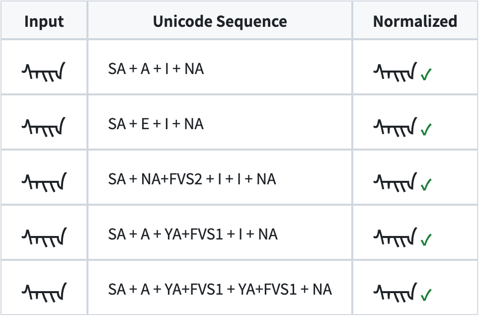

# mongol-norm

[](https://pypi.org/project/mongol-norm/)
[](https://pypi.org/project/mongol-norm/)
[](https://crates.io/crates/mongol-norm)
[](https://github.com/Satsrag/mongol-norm/actions/workflows/test.yml)

mongol-norm is a Traditional Mongolian (Hudum) same-shape comparison and normalization tool.
传统蒙古文（回鹘式）同形比较与规范化工具。*中文见下半部分。*

---

## English

**mongol-norm** is a Traditional Mongolian (Hudum) same-shape comparison and normalization tool.
It is implemented according to the Mongolian shaping rules of UTN #57 (GB/T 25914—2023). It
converts Mongolian text that has the same written form but different Unicode encodings into a
unified encoding, making search, deduplication, and corpus processing easier.

This package is a thin binding over the Rust crate
[`mongol-norm`](https://crates.io/crates/mongol-norm); both give byte-identical results.

### Input requirements

This library is intended for Mongolian text under the UTN #57 (GB/T 25914—2023) rules. Text that
uses other standards or encodings — for example Delehi, Oyun, and Menk related to
GB/T 25914—2010, as well as Menk old shape codes, ZCode, Zvvnmod, and the like — must first be
converted to UTN #57 (GB/T 25914—2023) before this library can be used. For encoding conversion,
you may consider [`mongol-convert`](https://github.com/Satsrag/mongol-convert); that library is
also currently in Beta, so use it with care and verify the conversion results.

### An example

The following spellings look the same, but their Unicode encodings differ, so a direct string
comparison treats them as different text. mongol-norm can tell that they have the same shape
and produce the same normalized result.



### Install

```bash
pip install mongol-norm
```

CPython ≥ 3.9. The engine is compiled into the extension, so there are no runtime dependencies and
no Rust toolchain to install. Prebuilt `cp39-abi3` wheels:

| Platform | Wheels |
|---|---|
| Linux x86_64 / aarch64 | glibc (manylinux2014) and musl (musllinux_1_2) |
| macOS | x86_64 and Apple silicon (arm64) |
| Windows | x64 |

On any other platform pip falls back to the source distribution, which compiles the extension
locally and needs Rust ≥ 1.83. The install also puts the `mongol-norm` command on `PATH`.

### Usage

> **Beta.** `normalize` output is a unified encoding by **glyph shape**, **not standard spelling**,
> and may change in a later release. Keep the original text; when storing normalized keys, also
> record `shaper.canonical_version` and rebuild after a version change.

```python
from mongol_norm import MongolianShaper

shaper = MongolianShaper(locale="MNG")

shaper.shape("ᠰᠠᠢᠨ")          # U+1830 (SA) U+1820 (A) U+1822 (I) U+1828 (NA) → ['S', 'A', 'I', 'I', 'A']
shaper.shape("ᠰᠡᠢᠨ")          # U+1830 (SA) U+1821 (E) U+1822 (I) U+1828 (NA) → ['S', 'A', 'I', 'I', 'A']
shaper.shape("ᠰᠨ᠌ᠢᠢᠨ")        # U+1830 (SA) U+1828 (NA) U+180C (FVS2) U+1822 (I) U+1822 (I) U+1828 (NA) → ['S', 'A', 'I', 'I', 'A']
shaper.shape("ᠰᠠᠶ᠋ᠢᠨ")        # U+1830 (SA) U+1820 (A) U+1836 (YA) U+180B (FVS1) U+1822 (I) U+1828 (NA) → ['S', 'A', 'I', 'I', 'A']
shaper.shape("ᠰᠠᠶ᠋ᠶ᠋ᠨ")      # U+1830 (SA) U+1820 (A) U+1836 (YA) U+180B (FVS1) U+1836 (YA) U+180B (FVS1) U+1828 (NA) → ['S', 'A', 'I', 'I', 'A']
shaper.shape_str("ᠰᠠᠢᠨ")                    # → 'S+A+I+I+A'
shaper.same_shape("ᠰᠠᠢᠨ", "ᠰᠡᠢᠨ")           # → True
shaper.normalize("ᠰᠡᠢᠨ")                    # → 'ᠰᠠᠢ᠍ᠢ᠍ᠠ᠌'
shaper.normalize_text("Hello ᠰᠡᠢᠨ world")   # → 'Hello ᠰᠠᠢ᠍ᠢ᠍ᠠ᠌ world'
shaper.canonical_version                    # → 'mng-canonical/5'

# Deduplicate
{shaper.normalize(w) for w in ["ᠰᠠᠢᠨ", "ᠰᠡᠢᠨ", "ᠰᠨ᠌ᠢᠢᠨ", "ᠰᠠᠶ᠋ᠢᠨ", "ᠰᠠᠶ᠋ᠶ᠋ᠨ"]}   # → {'ᠰᠠᠢ᠍ᠢ᠍ᠠ᠌'}
```

- `shape` / `normalize` take **one word** and raise `ValueError` on non-Mongolian characters; use
  `normalize_text` for sentences and mixed-script text.
- A shape the built-in table cannot encode raises `NormalizationFallbackError` (a `ValueError`,
  with `.text` and `.written_units`). Pass `strict=False` to get the input back unchanged instead.
- Locale: `"MNG"` (Hudum), the only one. Todo, Sibe and Manchu are not supported.

Written-unit input, if you already have a shape:

```python
shaper.normalize_written_units(["B", "Aa"])            # → 'ᠪᠠ᠋'
shaper.normalize_positioned_written_units([
    {"unit": "B", "position": "init"},
    {"unit": "Aa", "position": "fina"},
])                                                     # → 'ᠪᠠ᠋'
shaper.parse_written_units("B+Aa")                     # → ['B', 'Aa']
```

Debugging: `shape_detailed(text)` (per-letter breakdown), `trace(text)` (rule-by-rule trace),
`rule_names()`.

### Command line

```bash
mongol-norm shape 'ᠰᠠᠢᠨ'                  # → S+A+I+I+A
mongol-norm same 'ᠰᠠᠢᠨ' 'ᠰᠡᠢᠨ'            # exit 0 if identical, 1 if not
mongol-norm normalize 'ᠰᠡᠢᠨ'
mongol-norm normalize-text -i in.txt -o out.txt
mongol-norm normalize --batch -i words.txt -o keys.txt   # one word per line
```

`mongol-norm --help` lists every option.

### Links

- Source, issues, docs: <https://github.com/Satsrag/mongol-norm>
- How it works: [`docs/internals.md`](https://github.com/Satsrag/mongol-norm/blob/main/docs/internals.md)
- License: MIT. Rules and data derived from UTN #57 and
  [mongfontbuilder](https://github.com/Kushim-Jiang/mongfontbuilder) (MIT); see
  [NOTICE](https://github.com/Satsrag/mongol-norm/blob/main/NOTICE).

---

## 中文

**mongol-norm** 是一个传统蒙古文（回鹘式）的同形比较与规范化工具，依据 UTN #57（GB/T 25914—2023）的蒙古文整形规则实现。它将书写形态相同、Unicode 编码不同的蒙古文转换为统一编码，方便搜索、去重和语料处理。

本包是 Rust crate [`mongol-norm`](https://crates.io/crates/mongol-norm) 的薄绑定，结果与 crate 逐字节相同。

### 输入要求

本库面向 UTN #57（GB/T 25914—2023）规则下的蒙古文文本。采用其他标准或编码的文本，例如 GB/T 25914—2010 相关的 Delehi、Oyun、Menk，以及 Menk 旧形码、ZCode、Zvvnmod 等，需要先转换为 UTN #57（GB/T 25914—2023），才能使用本库。编码转换可考虑使用 [`mongol-convert`](https://github.com/Satsrag/mongol-convert)，该库目前也处于 Beta 阶段，请谨慎使用，并核对转换结果。

### 一个例子

下面几种写法看起来相同，但 Unicode 编码不同，直接比较字符串会被当作不同文本。mongol-norm 可以判断它们同形，并生成相同的规范化结果。


### 安装

```bash
pip install mongol-norm
```

CPython ≥ 3.9。引擎已编译进扩展模块，无运行时依赖，也不需要安装 Rust 工具链。预编译 `cp39-abi3` wheel：

| 平台 | wheel |
|---|---|
| Linux x86_64 / aarch64 | glibc（manylinux2014）与 musl（musllinux_1_2） |
| macOS | x86_64 与 Apple silicon（arm64） |
| Windows | x64 |

其他平台 pip 会回退到源码包，在本地编译扩展，需要 Rust ≥ 1.83。安装后同时会有 `mongol-norm` 命令。

### 用法

> **Beta 提醒：** `normalize` 输出的是**按字形统一的编码**，**不是标准拼写**，后续版本可能变化。建议保留原文；保存规范化键时，同时记录 `shaper.canonical_version`，版本变化后重建。

```python
from mongol_norm import MongolianShaper

shaper = MongolianShaper(locale="MNG")

shaper.shape("ᠰᠠᠢᠨ")          # U+1830 (SA) U+1820 (A) U+1822 (I) U+1828 (NA) → ['S', 'A', 'I', 'I', 'A']
shaper.shape("ᠰᠡᠢᠨ")          # U+1830 (SA) U+1821 (E) U+1822 (I) U+1828 (NA) → ['S', 'A', 'I', 'I', 'A']
shaper.shape("ᠰᠨ᠌ᠢᠢᠨ")        # U+1830 (SA) U+1828 (NA) U+180C (FVS2) U+1822 (I) U+1822 (I) U+1828 (NA) → ['S', 'A', 'I', 'I', 'A']
shaper.shape("ᠰᠠᠶ᠋ᠢᠨ")        # U+1830 (SA) U+1820 (A) U+1836 (YA) U+180B (FVS1) U+1822 (I) U+1828 (NA) → ['S', 'A', 'I', 'I', 'A']
shaper.shape("ᠰᠠᠶ᠋ᠶ᠋ᠨ")      # U+1830 (SA) U+1820 (A) U+1836 (YA) U+180B (FVS1) U+1836 (YA) U+180B (FVS1) U+1828 (NA) → ['S', 'A', 'I', 'I', 'A']
shaper.shape_str("ᠰᠠᠢᠨ")                    # → 'S+A+I+I+A'
shaper.same_shape("ᠰᠠᠢᠨ", "ᠰᠡᠢᠨ")           # → True
shaper.normalize("ᠰᠡᠢᠨ")                    # → 'ᠰᠠᠢ᠍ᠢ᠍ᠠ᠌'
shaper.normalize_text("Hello ᠰᠡᠢᠨ world")   # → 'Hello ᠰᠠᠢ᠍ᠢ᠍ᠠ᠌ world'
shaper.canonical_version                    # → 'mng-canonical/5'

# 去重
{shaper.normalize(w) for w in ["ᠰᠠᠢᠨ", "ᠰᠡᠢᠨ", "ᠰᠨ᠌ᠢᠢᠨ", "ᠰᠠᠶ᠋ᠢᠨ", "ᠰᠠᠶ᠋ᠶ᠋ᠨ"]}   # → {'ᠰᠠᠢ᠍ᠢ᠍ᠠ᠌'}
```

- `shape` / `normalize` 只处理**单个词**，遇到非蒙古文字符抛 `ValueError`；句子或混合文本用 `normalize_text`。
- 内置表无法编码的 shape 抛 `NormalizationFallbackError`（`ValueError` 子类，带 `.text`、`.written_units`）；
  传 `strict=False` 则原样返回。
- locale：只有 `"MNG"`（回鹘式），不支持托忒文、锡伯文、满文。

书写单元输入、调试接口和命令行见上方英文部分，用法相同。
